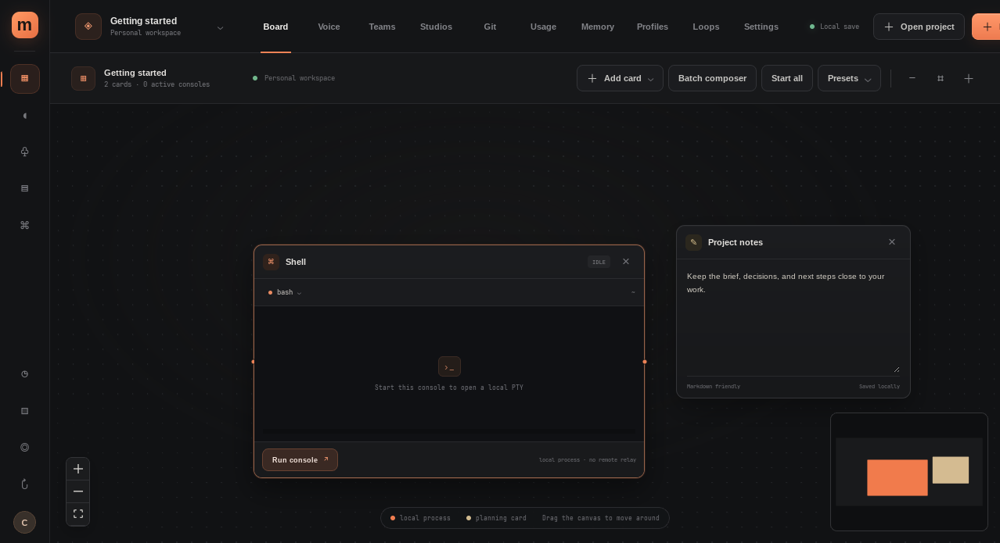

<div align="center">
  
  <h1>Megavibe</h1>
  <p><strong>A native Linux workspace for coding agents.</strong></p>
  <p>Keep local terminals, project notes, plans, and on-device voice planning together on one flexible board.</p>
  <p>
    <a href="https://github.com/cayleb-james2008/megavibe/releases/latest">Download for Linux</a>
    · <a href="docs/RESEARCH.md">Product scope</a>
    · <a href="docs/VOICE.md">Local voice setup</a>
  </p>
</div>

<p align="center">
  
</p>

## A workspace for the whole project

Megavibe is a Linux desktop implementation based on Hypervibe's public product information. It puts local coding consoles and the context around them on a movable, zoomable board.

- **Build a project board** with terminal, notes, checklist, kanban, text, calendar, web preview, drawing, image markup, code snapshot, and diagram cards.
- **Work with local coding CLIs** such as Claude Code, Codex, and Gemini CLI, or launch any executable with its arguments. Restore recent console output after restart and resume supported CLI sessions.
- **Coordinate terminal teams** with saved roles, a 12-slot batch launcher, @mentions, editable handoff briefs, mission status, and downloadable reports.
- **Plan with local voice** using on-device speech recognition and an on-device language model. Approve proposed board changes before they are applied.
- **Keep project context close** with global and per-project memory, a Markdown vault, repository-aware studios, local Git status, and CLI usage charts.
- **Control automation** with bounded local loops, configurable permission modes, and explicit confirmation before staged Git commits or remote actions.

## Download

Get the latest build from [GitHub Releases](https://github.com/cayleb-james2008/megavibe/releases/latest):

- **Debian or Ubuntu:** `Megavibe_0.1.0_amd64.deb`
- **Other compatible x86_64 Linux systems:** `Megavibe_0.1.0_linux_x86_64.tar.gz`; extract it and run `./megavibe` from the extracted directory.

Both packages need GTK 3, WebKitGTK 4.1, and ALSA from the system. The portable archive includes the CPU voice runtime. Megavibe downloads voice model files only when you choose to set up voice planning. Release checksums are published alongside the packages.

## Build from source

Install Node.js, npm, Rust, Cargo, and the [Tauri Linux prerequisites](https://v2.tauri.app/start/prerequisites/). On Arch Linux, the relevant packages include `webkit2gtk-4.1`, `gtk3`, `librsvg`, `patchelf`, and a C/C++ toolchain.

```sh
npm install
npm run tauri dev
```

Build the Debian package and portable archive with:

```sh
npm run tauri -- build
npm run package:linux:tarball
```

## Local by default

Board state, workspaces, team roles, profiles, memory, loops, images, and viewport positions are saved in Megavibe's per-user application data directory. Voice audio, recognition, planning, and speech stay on the device; after models are downloaded, voice planning works offline. The app has no telemetry, hosted account, subscription, or auto-update service.

Terminal processes are local and may use credentials or services configured in the user's environment. CLI profiles keep separate CLI configuration directories, but are not operating-system security sandboxes. Web previews load the URL you enter. GitHub metadata and remote Git actions use your configured `gh` login or Git credential helper only after you choose the action and confirm it.

## Scope and limits

This project reproduces public product concepts, not Hypervibe's private code or services. A signed-in Hypervibe build was not available for inspection. Megavibe's local voice models may plan less consistently than a hosted system, and its bundled spoken voice is US English. Hypervibe accounts and billing, its CLI event-hook protocol, the embedded Web Inspector, and signed updater are not reproduced.

Handoff drafts summarize recent terminal output and need review. Mission state is inferred from recent output and permission prompts. Loop completion markers become candidates for confirmation; loops run only while Megavibe and the target console are running. Prepared prompts are never submitted automatically. See the [research record](docs/RESEARCH.md) for the public-spec comparison and [voice guide](docs/VOICE.md) for model and data details.

Megavibe saves up to 32 MB of local state. Per-console output is held in memory up to 512 KiB, with the last 128 KiB saved for display after restart. Console relaunch on shutdown requires confirmation. Repository browsing skips symlinks and common generated directories and is bounded by entry, depth, and file-size limits; the Markdown vault also reports when its listing reaches its limit.
